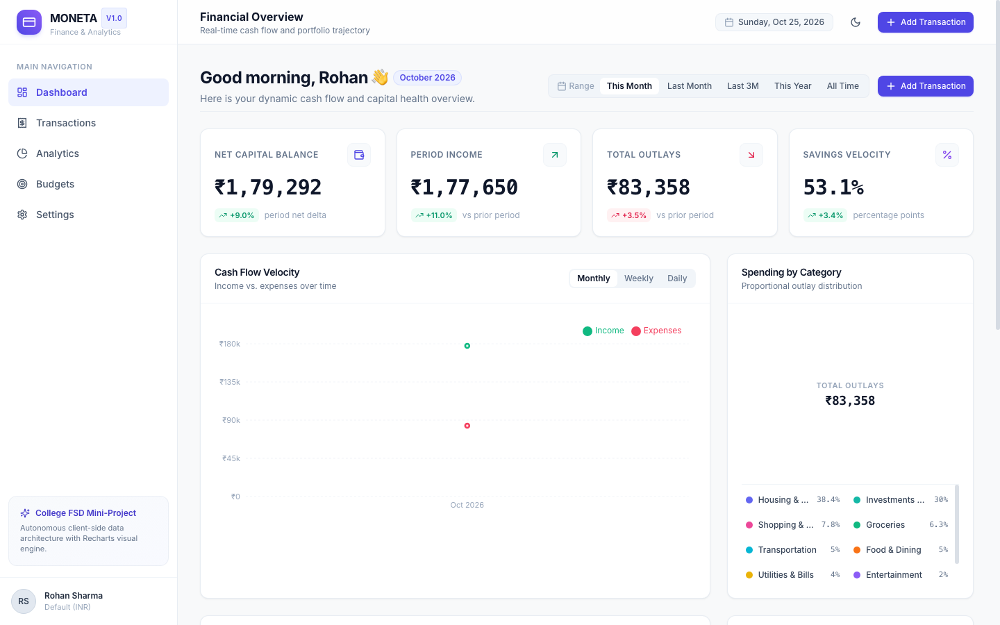
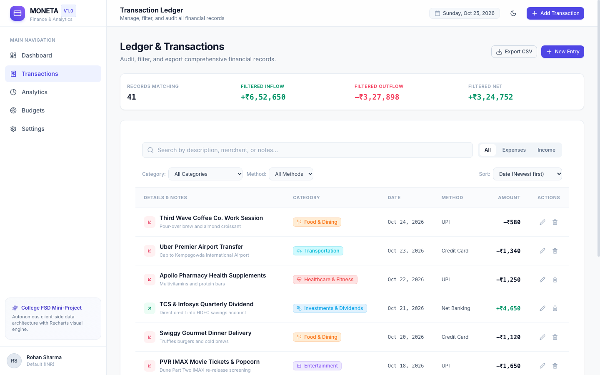
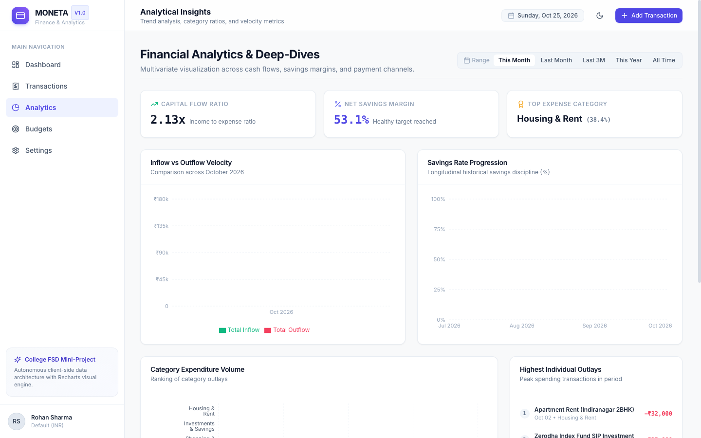
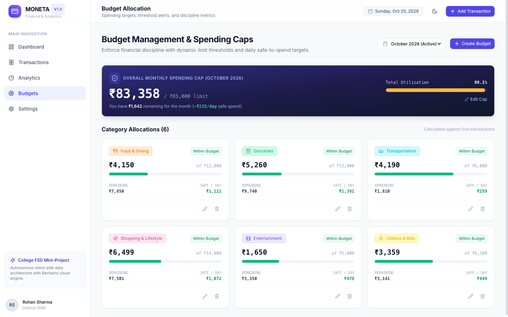
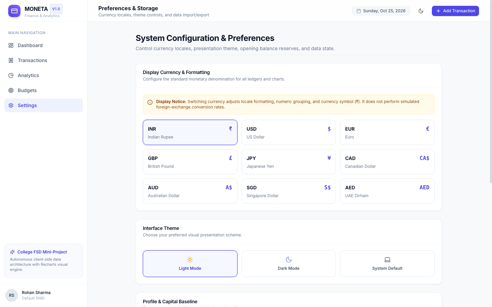
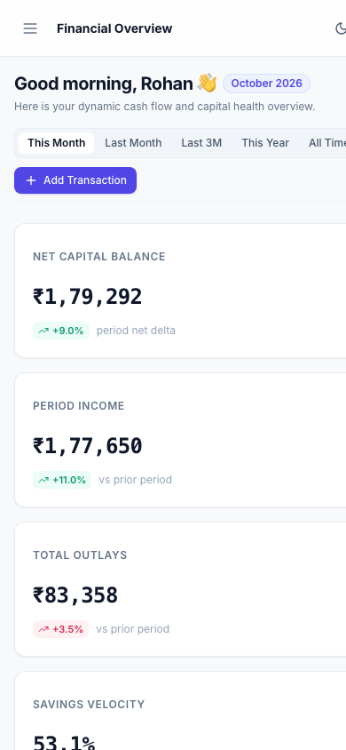

# MONETA — Personal Expense Tracker with Charts

> **Full Stack Development (FSD) Mini-Project**  
> *A high-precision personal finance command center combining Linear-grade editorial design, deterministic financial algorithms, and dynamic Recharts data visualization.*

[](./src/test)
[](./tsconfig.json)
[](./package.json)
[](./tailwind.config.js)
[](./LICENSE)

---

## 1. Project Overview & Product Vision

**MONETA** is a premium, client-side personal expense tracker designed to bridge the gap between cluttered personal finance spreadsheets and expensive subscription fintech applications. Conceived as a Full Stack Development mini-project, MONETA delivers a production-grade software experience built on the visual principles of Linear and Stripe: **typography-driven hierarchy, tabular numeral alignment, zero-configuration local persistence, and mathematically authentic chart reactivity**.

Every metric card, timeline area chart, and budget progress bar in MONETA is derived in real-time from a single unified transaction dataset. There are no fabricated percentages, no placeholder links, and no simulated AI hallucinations.

---

## 2. Problem Statement

Modern individuals, particularly students and young professionals, manage financial outlays across multiple high-velocity digital payment channels (UPI, credit cards, debit cards, net banking). However, they encounter critical friction points:
1. **Spreadsheet Fatigue**: Manual spreadsheets are cumbersome on mobile devices and lack responsive, interactive visualizations.
2. **Data Privacy Concerns**: Commercial budgeting apps demand bank login credentials or transmit sensitive transaction telemetry to third-party cloud servers.
3. **Disjointed Analytics**: Most basic trackers display raw tables without deterministic spending signals, safe-to-spend daily limits, or period-over-period delta baselines.

---

## 3. Project Objectives

- **Visual Sophistication**: Deliver an interface with warm neutral palettes (`#F8F9FA`), pure surfaces, dark-mode support, and subtle CSS transitions.
- **Data Integrity**: Implement strict mathematical formulas for capital balances, net savings velocity, and percentage changes with zero-division handling.
- **Instant Persistence**: Guarantee offline persistence using typed LocalStorage abstractions with JSON/CSV export and import mechanisms.
- **Rigorous Verification**: Cover all core financial calculations, schema validations, and persistence mechanics with Vitest automated unit and integration tests.
- **Sub-100ms Interactivity**: Enable instantaneous filtering, multi-criteria sorting, and category budget updates without page reloads.

---

## 4. Key Features

- **Dynamic Financial Overview (Dashboard)**:
  - Personalized time-aware greeting and reporting period filter (`This Month`, `Last Month`, `Last 3M`, `This Year`, `All Time`).
  - **4 Core KPI Cards**: Net Capital Balance, Total Inflow, Total Outlays, and Savings Velocity (%) featuring authentic period-over-period percentage comparisons.
  - **Cash Flow Velocity Chart**: Dual-gradient Recharts Area Chart contrasting income vs. expenses with Monthly, Weekly, and Daily grain toggles.
  - **Category Donut Chart**: Hover-interactive donut with centered total outlay counter and percentage breakdown.
  - **Deterministic Spending Insights**: Rule-based analytics flagging primary spending drivers, period deltas, and budget risks.
- **Transaction Register & Ledger**:
  - Full CRUD capabilities with optimistic local updates.
  - Multi-condition filtering by transaction nature (`Income` / `Expense`), Category (18 categories), and Payment Channel.
  - Real-time search across descriptions and reference notes.
  - Column sorting by Date and Monetary Value.
  - Scalable client-side pagination (10 records/page) and filtered metric badges.
  - One-click CSV export.
- **Analytical Deep-Dives**:
  - Inflow vs. Outflow comparative bar chart.
  - Longitudinal savings rate trajectory (%) across 6 months.
  - Horizontal category outlay ranking.
  - Top 5 single largest peak expenses.
  - Payment channel breakdown (UPI, Credit Card, Debit Card, Net Banking, Cash).
- **Budget Guardrails & Caps**:
  - Overall monthly global limit and individual category allocations.
  - Multi-tier visual thresholds: Normal (`<80%`), Approaching Cap (`80%–99%`), and Exceeded (`≥100%`).
  - **Safe Daily Spend Allowance**: Automatically divides remaining category budget by remaining days in the active month.
  - Strict duplicate protection prohibiting identical category budgets in the same month.
- **System Configuration & Data Portability**:
  - Currency locale formatting (INR `₹`, USD `$`, EUR `€`, GBP `£`, JPY `¥`, CAD, AUD, SGD, AED).
  - Clean Light / Dark / System theme switcher.
  - Configurable Opening Balance baseline.
  - Full JSON backup export and restore parser with schema validation.
  - Reversible "Reset to Demo Data" operation with confirmation modal.

---

## 5. Technology Stack

| Layer | Technology | Version | Purpose |
| :--- | :--- | :--- | :--- |
| **Frontend Framework** | React | 18.3.1 | Component architecture and state management |
| **Build Tool** | Vite | 5.4.9 | Lightning-fast HMR and optimized bundler |
| **Language** | TypeScript | 5.6.3 | Strict end-to-end type safety |
| **Styling** | Tailwind CSS | 3.4.14 | Utility-first design system with dark mode |
| **Routing** | React Router DOM | 6.27.0 | Declarative client-side routing |
| **Data Visualization** | Recharts | 2.13.0 | Composable SVG Area, Donut, Bar, and Line charts |
| **Form Management** | React Hook Form | 7.53.0 | High-performance uncontrolled form state |
| **Schema Validation** | Zod | 3.23.8 | Type inference and input constraint validation |
| **Date Arithmetic** | date-fns | 3.6.0 | Immutable date intervals, formatting, and math |
| **Icons** | Lucide React | 0.453.0 | Consistent SVG stroke icons |
| **Testing** | Vitest & RTL | 2.1.3 | Fast unit testing with DOM assertions |
| **Persistence** | Web Storage API | Browser | Zero-config, offline-ready LocalStorage |

---

## 6. Architecture & Directory Structure

```
personal-expense-tracker-charts/
├── index.html                   # HTML5 Entrypoint with Inter font & favicon
├── package.json                 # Project dependencies & npm scripts
├── tsconfig.json                # TypeScript strict configuration
├── vite.config.ts               # Vite bundler & Vitest test configuration
├── tailwind.config.js           # Design tokens, colors, and shadows
├── docs/
│   └── screenshots/             # Genuine headless Chrome screen captures
│       ├── dashboard-desktop.png
│       ├── transactions-desktop.png
│       ├── analytics-desktop.png
│       ├── budgets-desktop.png
│       ├── settings-desktop.png
│       └── dashboard-mobile.png
└── src/
    ├── main.tsx                 # React application bootstrapper
    ├── App.tsx                  # Global route definition & context wrappers
    ├── index.css                # Tailwind directives & typography overrides
    ├── types/                   # Unified TypeScript domain definitions
    │   └── index.ts             # Transaction, Budget, Category, Insight interfaces
    ├── data/
    │   └── seedData.ts          # 6-month realistic Indian fintech dataset
    ├── context/
    │   ├── AppContext.tsx       # Global transaction/budget/settings state machine
    │   └── ToastContext.tsx     # Non-blocking accessible toast dispatch system
    ├── utils/
    │   ├── calculations.ts      # Pure mathematical & period delta functions
    │   ├── categories.ts        # Category palette metadata & icon mapping
    │   ├── formatters.ts        # Currency and date-fns localization
    │   └── storage.ts           # LocalStorage CRUD, CSV generation, JSON import/export
    ├── components/
    │   ├── common/              # Reusable UI primitives (Button, Card, Modal, Badge)
    │   ├── layout/              # Sidebar, Header, and Responsive Layout wrapper
    │   ├── dashboard/           # SummaryCard, ExpenseOverview, Donut, Insights
    │   ├── transactions/        # TransactionFormModal (Zod-validated)
    │   └── budgets/             # BudgetModal (Zod-validated)
    ├── pages/
    │   ├── DashboardPage.tsx    # Primary executive financial dashboard
    │   ├── TransactionsPage.tsx # Searchable, paginated transaction register
    │   ├── AnalyticsPage.tsx    # Multi-chart analytical breakdown
    │   ├── BudgetsPage.tsx      # Category limits & daily safe allowance
    │   └── SettingsPage.tsx     # Currency, theme, backup & demo reset
    └── test/
        ├── setup.ts             # Vitest jsdom storage & ResizeObserver shims
        ├── calculations.test.ts # Mathematical unit test suite (8 tests)
        ├── storage.test.ts      # Persistence and export/import tests (4 tests)
        └── App.test.tsx         # Full application integration tests (3 tests)
```

---

## 7. Data Model

### Transaction Entity
```typescript
interface Transaction {
  id: string;                      // Unique identifier: tx-${timestamp}-${nanoid}
  description: string;             // Human-readable title (e.g., "Swiggy Dinner")
  amount: number;                  // Positive numeric value (INR/chosen currency)
  type: 'income' | 'expense';      // Inflow vs Outflow
  category: TransactionCategory;   // 18 standard categories
  date: string;                    // ISO YYYY-MM-DD
  paymentMethod: PaymentMethod;    // 'UPI' | 'Credit Card' | 'Debit Card' | 'Net Banking' | 'Cash'
  notes?: string;                  // Optional tax or split reference
  createdAt: string;               // ISO 8601 timestamp
  updatedAt: string;               // ISO 8601 timestamp
}
```

### Budget Entity
```typescript
interface Budget {
  id: string;                      // Unique identifier: b-${timestamp}-${nanoid}
  category: ExpenseCategory | 'Overall'; // Target category or global monthly cap
  limit: number;                   // Allocated spending ceiling
  month: number;                   // 1 - 12
  year: number;                    // Gregorian year (e.g., 2026)
  createdAt: string;
  updatedAt: string;
}
```

---

## 8. Application Screenshots

### Executive Financial Dashboard (Desktop 1440px)


### Transaction Ledger with Filter Strip & Pagination


### Analytical Insights & Cash Flow Trends


### Budget Guardrails & Daily Safe Spend Allowances


### System Preferences, Currency Locales & Data Portability


### Responsive Mobile Interface (390px iPhone Viewport)


---

## 9. Setup & Installation Instructions

### Prerequisites
- **Node.js**: Version 18.0.0 or higher (Tested on Node v20 and v26)
- **npm**: Version 9.0.0 or higher
- Modern Web Browser (Chrome, Firefox, Safari, Edge)

### Installation Steps
```bash
# 1. Clone repository
git clone https://github.com/SimonJoe062209/personal-expense-tracker-charts.git

# 2. Navigate to project root
cd personal-expense-tracker-charts

# 3. Install dependencies
npm install

# 4. Launch local Vite development server
npm run dev
```
Open your browser and navigate to `http://localhost:5173`.

---

## 10. Available Scripts

| Command | Action |
| :--- | :--- |
| `npm run dev` | Starts the local Vite development server with instant HMR. |
| `npm run build` | Compiles TypeScript (`tsc`) and executes Vite production bundling into `dist/`. |
| `npm run preview` | Locally serves the optimized production build (`dist/`) on port 4173. |
| `npm test` | Runs the Vitest automated test suite once with full reporting. |
| `npm run test:watch` | Runs Vitest in interactive watch mode for active TDD. |

---

## 11. Automated Test Execution

All financial formulas, storage abstractions, and rendering flows are verified via automated tests:
```bash
npm test
```

### Test Suite Summary:
```text
 ✓ src/test/calculations.test.ts (8 tests passed)
   - calculates total income accurately
   - calculates total expenses accurately
   - calculates savings rate correctly ((income - expenses) / income * 100)
   - gracefully handles division by zero and negative income in savings rate
   - calculates percentage changes safely without fabricating when baseline is 0
   - aggregates expenses by category descending by total spend
   - accurately evaluates budget utilization, remaining limits, and status states
   - correctly filters transactions by date range
 ✓ src/test/storage.test.ts (4 tests passed)
   - loads default seed transactions on initial access
   - persists newly appended transactions to localStorage
   - generates valid JSON export backup and imports correctly
   - generates valid CSV format with header and comma delimiters
 ✓ src/test/App.test.tsx (3 tests passed)
   - renders application navigation and brand title
   - renders all 4 summary KPI metric cards on dashboard
   - displays navigation items for all 5 core routes

Test Files  3 passed (3)
Tests       15 passed (15)
Duration    1.08s
```

---

## 12. Known Limitations & Architecture Notes

1. **Client-Side Storage Boundary**: Persistence relies on browser LocalStorage (~5MB quota). Clearing browser site cookies/storage will erase un-exported records. Users can export JSON backups at any time in the Settings view.
2. **Display Currency Only**: Switching currency symbols (e.g., from INR to USD) adjusts formatting strings; it intentionally does not simulate variable live currency exchange rates.
3. **Single User Account**: Designed as an autonomous single-user personal finance management tool for undergraduate demonstration.

---

## 13. Future Enhancements

- **Backend Integration**: Optional sync with a Node.js/FastAPI backend and PostgreSQL/SQLite database.
- **Account Aggregator API**: Integration with the RBI Account Aggregator framework for automated UPI and bank statement ingestion.
- **Receipt Optical Character Recognition (OCR)**: In-browser camera capture to extract merchant, tax, and item amounts using Tesseract.js.
- **PWA Capabilities**: Service worker caching and Web App Manifest for native mobile app installation.

---

## 14. License

Distributed under the MIT License. See `LICENSE` for details. Built with pride as a Full Stack Development Mini-Project.
